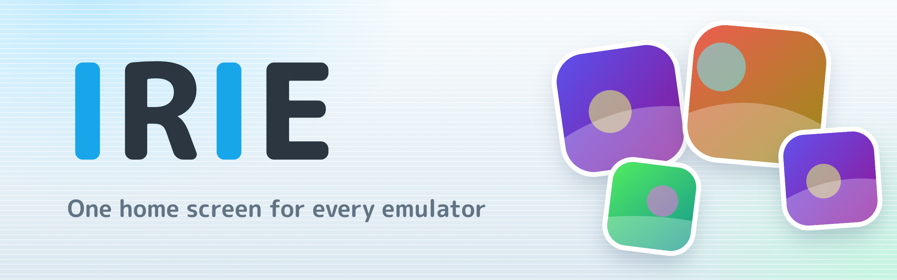
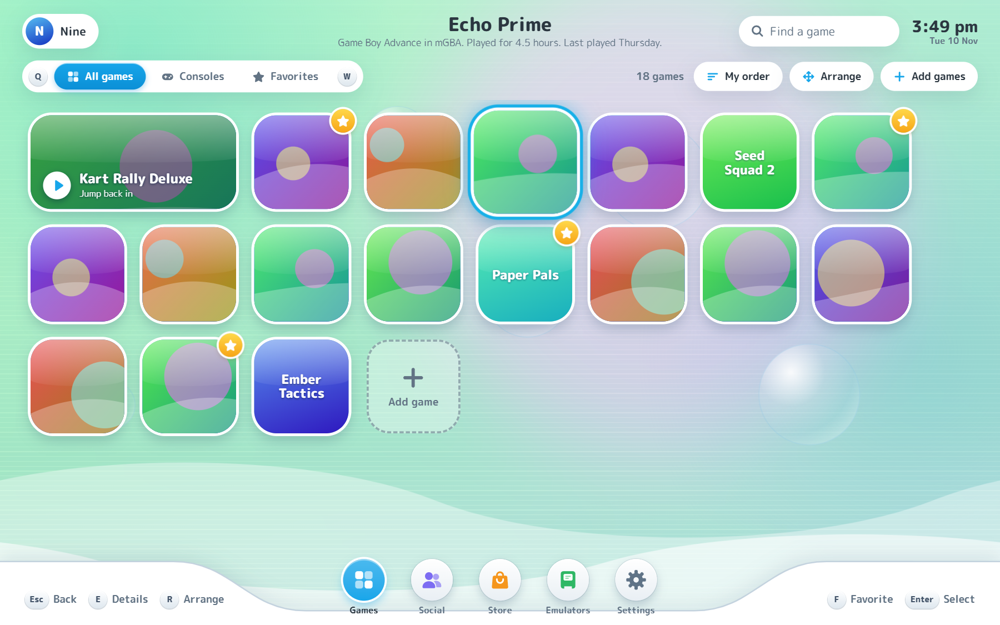
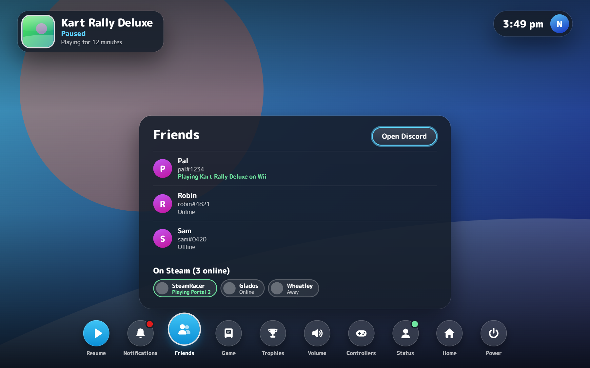
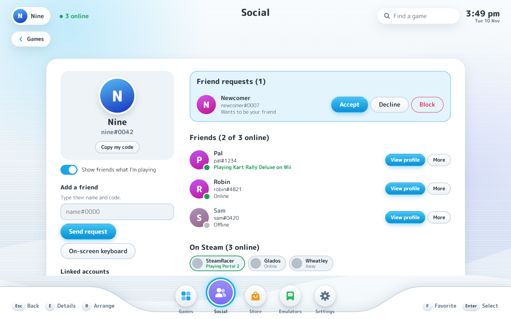
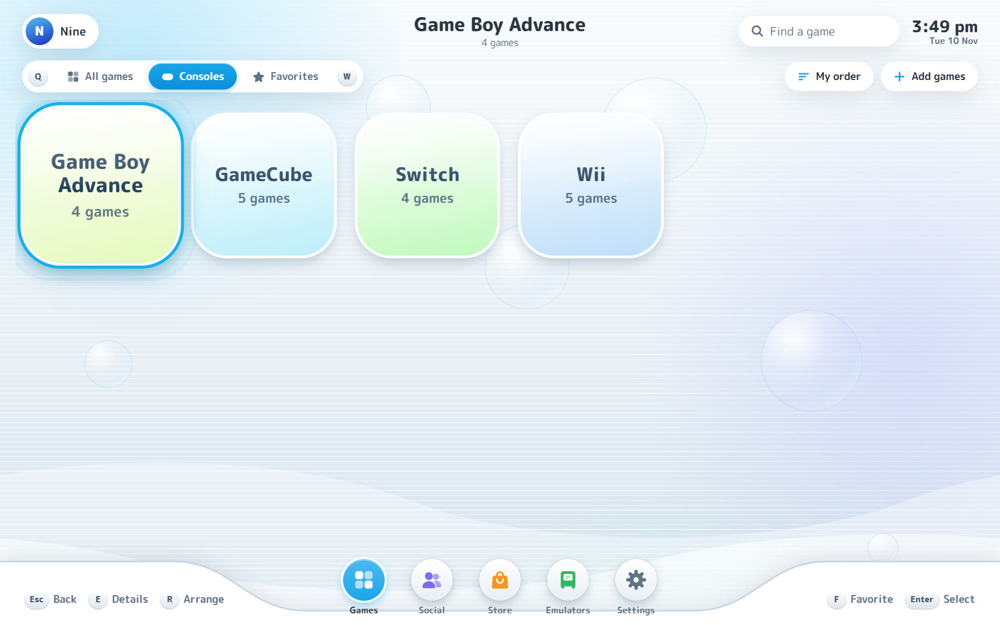
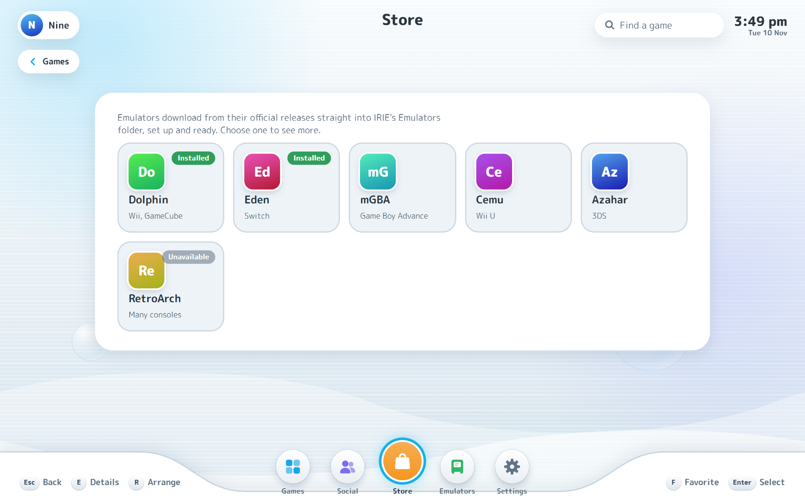

  

  
  
  

  <b>IRIE puts every emulator, and your Steam library, on one console-style home screen.</b> 
  Pick a game and it starts in the right emulator. Press home mid-game for a pause menu with your friends, trophies, volume and controllers.

  <a href="https://github.com/Geedorahz/IRIE/releases/latest"><b>Download for Windows</b></a>

  

> IRIE is only a launcher. It includes no games, BIOS files, keys or emulators, and it is not affiliated with any console maker, emulator project or store.

## What you get

- **One home for everything.** Add an emulator once, drop in a game or a whole folder, and IRIE works out each game's console, finds its cover, and starts it in the emulator you chose. A Switch game can sit next to a Wii game and both start with one press.
- **Made for a controller.** Move with the D-pad or stick, `Q` and `W` (or the shoulder buttons) switch between All games, Consoles and Favorites, and every screen works without a mouse. Xbox, DualSense, DualShock 4 and Switch Pro controllers are recognised on their own.
- **A pause menu over your game.** Press the Guide button, Select + Start, or Ctrl + Alt + Home. The game freezes with its picture still behind a row of buttons: friends, trophies, volume, controller order and more.
- **Steam alongside your emulators.** Installed Steam games join the library, with their play history and achievements.
- **Friends.** Make an account with an emailed code, add friends by `name#1234`, and see who is playing what. Your Steam, Discord and Pretendo friends show up in their own small sections.
- **Trophies.** Steam achievements and RetroAchievements, in the pause menu and on your profile.
- **Several people, one PC.** Each user keeps their own favorites, play time, arrangement and Dolphin saves.
- **A store for emulators.** Download popular emulators from their official releases, already set up.
- **Yours to restyle.** Themes change the wallpaper, colors and music, and can be shared as one file.
- **Light.** In Lite Mode the menu uses about 120 MB, and while a game runs IRIE closes itself and leaves a 2 MB helper to keep time and reopen the menu.

## A look around

<table>
  <tr>
    <td width="50%"> <b>Pause menu</b> over the frozen game</td>
    <td width="50%"> <b>Social</b>: IRIE friends first, other platforms below</td>
  </tr>
  <tr>
    <td width="50%"> <b>Consoles</b>: browse by system</td>
    <td width="50%"> <b>Store</b>: emulators, set up and ready</td>
  </tr>
</table>

## Install

1. Download `IRIE-windows.zip` from the [latest release](https://github.com/Geedorahz/IRIE/releases/latest).
2. Unzip it somewhere permanent, such as `C:\IRIE`. Keep `IRIE.exe` and `irie-watch.exe` in the same folder.
3. Run `IRIE.exe`.

Windows may say it protected your PC the first time, because IRIE isn't code-signed. Choose **More info**, then **Run anyway**.

IRIE needs Windows 10 or 11 with the WebView2 Runtime, which most PCs already have. It checks for a newer release each time it opens, installs it in the background, and starts it the next time you open IRIE. Your library lives in `%APPDATA%\IRIE`.

## Set it up

1. Open **Emulators** and add each emulator you have, or press **Find emulators on this PC**.
2. Press **Add games**, drop files or a folder onto the window, or use **Scan folder** on an emulator.
3. Press `E` on a game for its icon, other versions to play, and per-game settings.

## Controls

| Action | Controller | Keyboard |
| --- | --- | --- |
| Move | D-pad or left stick | Arrow keys |
| Play or select | A | Enter |
| Back | B | Esc |
| Favorite | Y | F |
| Details | X | E |
| Arrange games | Select | R |
| Change section | LB / RB | Q / W |
| Settings | Start | |
| Fullscreen | | F11 |

In a game, the pause menu opens with the Guide button, Select + Start, or Ctrl + Alt + Home. Emulators need to run borderless fullscreen for it to show, which the built-in Dolphin and Lichii commands do.

## The pause menu

| Button | What it does |
| --- | --- |
| Resume | Back to the game |
| Notifications | Friend requests |
| Friends | Who is online, and a button that opens Discord over the menu |
| Game | The game's details, switching to another version, and opening its emulator's settings |
| Trophies | This game's Steam or RetroAchievements trophies |
| Volume | The game's own volume (or the PC's, when the game's sound can't be found) |
| Controllers | Connected controllers with battery, player order for the next game, and button editing |
| Status | Appear online or offline, which also hides your game from your Discord profile |
| Home | Close the game and go back to IRIE |
| Power | Close the game and leave IRIE closed |

## More

- [Accounts, Steam, Discord and RetroAchievements](docs/accounts-and-discord.md)
- [Themes](docs/themes.md)
